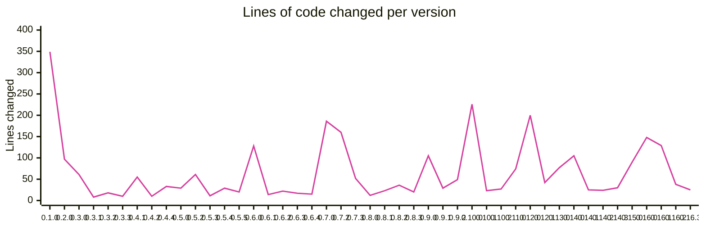
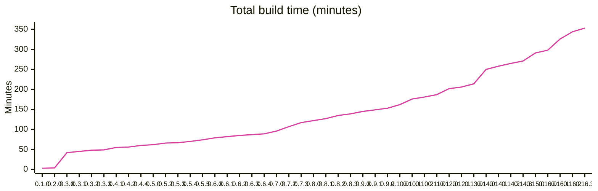

# Changelog

## Change graph

How much the app's code changed in each version (lines added + removed in `.html`, `.css`, `.js`, `.json`; docs not counted):

Total time spent so far (minutes, adds up the Summary table below):

Update both graphs with every release (add the new version at the right end).

## Summary

| Version | Date | Time | What changed |
|---|---|---|---|
| v0.16.3 | 2026-11-15 | 9 min | Azure character count turns pink from 80% of the monthly limit |
| v0.16.2 | 2026-11-15 | 18 min | Azure: clearer audio (higher quality, speed set by Azure instead of stretching) |
| v0.16.1 | 2026-11-15 | 28 min | Azure: several sentences per request, paced under the free plan's rate limit, key check on Save |
| v0.16.0 | 2026-11-15 | 7 min | Azure cloud voice (natural, light on the phone) with a built-in monthly character limit |
| v0.15.0 | 2026-11-15 | 20 min | English words inside Japanese sentences are read by the English voice; lighter voice measured |
| v0.14.3 | 2026-11-15 | 6 min | Natural voice switches back to Device by itself when the device is too slow; voice test page |
| v0.14.2 | 2026-11-15 | 7 min | Natural voice: "Making natural voice…" note while waiting; version shown in the 🐞 log |
| v0.14.1 | 2026-11-15 | 8 min | Natural voice: detects silent audio from the graphics chip and switches to CPU; more log detail |
| v0.14.0 | 2026-11-15 | 25 min | Natural Japanese voice (beta) in the player: open-source yomiscript + Kokoro, made on the device |
| — | 2026-11-13 | 11 min | Voice Lab experiment page (`lab/`): Japanese read by the open-source yomiscript / Kokoro engine |
| v0.13.0 | 2026-11-13 | 8 min | Read aloud continues with the next (older) email in the folder |
| v0.12.1 | 2026-11-13 | 4 min | Auto-update: the plain link always loads the newest version |
| v0.12.0 | 2026-11-13 | 15 min | Debug log (🐞) with crash detection; read-aloud freeze fixes; screen stays on while reading; change graphs |
| v0.11.0 | 2026-11-04 | 6 min | Stays signed in for the hour after reopening; one-tap / automatic renewal |
| v0.10.2 | 2026-11-04 | 5 min | Phone: double-tap an email or sheet = full screen on/off |
| v0.10.1 | 2026-11-04 | 14 min | Fix: phone back gesture closes and stops the YouTube video first |
| v0.10.0 | 2026-11-04 | 9 min | Watch later: save YouTube/other links, play YouTube inside AtsuMail, synced via Google Sheet |
| v0.9.2 | 2026-11-04 | 4 min | Sheet links (whole-cell, =HYPERLINK, part of text) work |
| v0.9.1 | 2026-11-04 | 4 min | Full screen for sheets (F key or ⛶ on the tab bar) |
| v0.9.0 | 2026-11-04 | 6 min | Sheets show the sheet's own colors, bold, alignment, merged cells, column widths |
| v0.8.3 | 2026-11-04 | 4 min | Pixel landscape: camera-side gap reduced to a thin margin |
| v0.8.2 | 2026-11-04 | 8 min | Phone sideways: no blank strip by the camera; only text keeps clear of it |
| v0.8.1 | 2026-11-04 | 5 min | Clearer error messages from Google; detects missing Sheets permission |
| v0.8.0 | 2026-11-04 | 5 min | Connected to Google: real Gmail + Myojin sheet (sign in required) |
| v0.7.3 | 2026-11-04 | 10 min | Privacy policy page (needed for Google sign-in setup) |
| v0.7.2 | 2026-11-01 | 11 min | Light-blue highlight on the sentence being read; tap a sentence to read from there |
| v0.7.0 | 2026-11-01 | 7 min | Built-in voice reader (EN + JA, Soft / Radio DJ / News); F key only for full screen |
| v0.6.4 | 2026-11-01 | 2 min | PC: plain F key also toggles full screen |
| v0.6.3 | 2026-11-01 | 2 min | PC: Ctrl+F turns full screen on/off while an email is open |
| v0.6.2 | 2026-11-01 | 3 min | Phone: back gesture / swipe on the list opens the folder screen |
| v0.6.1 | 2026-11-01 | 3 min | Myojin sheet link saved |
| v0.6.0 | 2026-11-01 | 5 min | Google Sheets view (SHEETS section) |
| v0.5.5 | 2026-11-01 | 4 min | Smaller folder list on PC, flat folder icons |
| v0.5.4 | 2026-11-01 | 3 min | Bigger A- / A+ text-size steps |
| v0.5.3 | 2026-11-01 | 1 min | Full-width text in PC full screen |
| v0.5.2 | 2026-11-01 | 4 min | Resizable panes on PC |
| v0.5.0 | 2026-11-01 | 2 min | Install on PC, app icon, keyboard shortcuts |
| v0.4.4 | 2026-11-01 | 4 min | Full-width landscape reading |
| v0.4.2 | 2026-11-01 | 1 min | Swipe to leave full screen |
| v0.4.0–0.4.1 | 2026-11-01 | 6 min | 🔊 read aloud via Text Reader, hide address bar on phones |
| v0.3.3 | 2026-11-01 | 1 min | Pink Inbox |
| v0.3.2 | 2026-11-01 | 3 min | Medium-size folder list |
| v0.3.1 | 2026-11-01 | 3 min | Phones always load the newest version |
| v0.3.0 | 2026-11-01 | 22 min | Swipe back from email, bigger folder list |
| — | 2026-11-01 | 16 min | Test checklist (QA.md), GitHub Pages setup |
| v0.2.0 | 2026-11-01 | 1 min | Reading mode, text size, full screen |
| v0.1.0 | 2026-11-01 | 3 min | First version: dark read-only Gmail reader with demo mode |
| **Total** | | **5 h 53 min** | |

Time = clock time from the previous release to this one (includes waiting and testing).
Add a new row at the top of this table for every release, and update the total.

---

## v0.16.3 — 2026-11-15 — time spent: 9 min

**What changed**
- The "Azure this month" count shows the percentage used and turns **pink and bold** from 80% of the monthly limit, in the player and in ⚙.

**Why**
- An early warning before the free amount runs out.

## v0.16.2 — 2026-11-15 — time spent: 18 min

**What changed**
- Azure audio is requested at higher quality (48 kHz / 96 kbit instead of 24 kHz / 48 kbit).
- The reading speed is now spoken by Azure itself (`prosody rate`) and the audio is played untouched, instead of the phone speeding it up afterwards. Changing speed or style fetches the current part again.

**Why**
- On the Pixel, katakana words sounded fuzzy with the Azure voice. Low-bitrate audio plus time-stretching blurs sharp consonants. (Not yet confirmed by ear that this fixes it.)

## v0.16.1 — 2026-11-15 — time spent: 28 min

**What changed**
- Azure: several sentences are sent in one request (about 80+ characters each time; the whole group is highlighted), never more than 14 requests in 60 seconds, and a busy/failed request is tried 3 times with a wait in between.
- Azure settings: **Save** now checks the key with one tiny request and says "✓ Azure key works" or what is wrong. A pasted web address or a too-short key is refused before anything is sent. The box shows how many characters were pasted (not the key). Region is tidied ("Japan East" → `japaneast`).
- Clearer notes when Azure can't be reached.

**Why**
- "Azure could not be reached 3 times": the free plan allows about 20 requests a minute and AtsuMail sent one per sentence.
- The copy icon in the Azure page pasted a web address instead of the key, and AtsuMail did not say so.

## v0.16.0 — 2026-11-15 — time spent: 7 min

**What changed**
- New voice choice in the player: **Azure (cloud)**. Natural Microsoft Azure voices for Japanese and English; nothing heavy runs on the phone.
- **⚙** in the player opens Azure settings: key, region, Japanese voice, English voice, monthly limit. Saved only in this browser. The key is never written to the 🐞 log.
- **Stays within the free amount:** AtsuMail counts the characters it sends each month the way Azure bills them (each Japanese character counts as 2) and stops at the limit (default 450,000 of the free 500,000), then uses the Device voice. The count shows in the player.
- Only one sentence is fetched ahead, because unused audio still counts.
- Wrong key/region (401/403), quota used up (429) or 3 network failures: a pink note explains and the Device voice takes over.
- "Natural (beta)" renamed "Natural (PC)".
- Privacy page: with Azure on, sentence text is sent to Microsoft.

**Why**
- On-device natural voices are too slow on the Pixel 10 (measured). A cloud voice is light on the phone and human-like.
- Uses the plain web address of Azure's speech service instead of the large Azure library Text Reader loads.

## v0.15.0 — 2026-11-15 — time spent: 20 min (estimate)

**What changed**
- Device voice: a Japanese sentence that contains English words is spoken in pieces. Japanese parts use the Japanese voice; English words of 3+ letters ("OpenAI", "machine learning", "iPhone 17 Pro") use the English voice instead of being spelled out. Short ones ("AI", "PC") stay with the Japanese voice.
- Test page `lab/test.html` now measures a second on-device voice, Supertonic 3 (new `lab/st_worker.js`).

**Why**
- English inside Japanese emails was read letter by letter.
- Looked for a lighter on-device natural voice for the Pixel. Measured on the PC (CPU, 4 threads): Supertonic 3 needs 1.45 s of work per 1 s of audio at full quality and 0.91 at reduced quality, and is a 380 MB download. That is not lighter than Kokoro (1.25), so it will not be fast enough on the Pixel either.

## v0.14.3 — 2026-11-15 — time spent: 6 min

**What changed**
- If the natural voice takes more than 1.4 s to make 1 s of audio, AtsuMail switches **JA voice** back to **Device**, shows a pink note in the player and writes it to the 🐞 log.
- New test page `lab/test.html`: one tap measures 4 ways of running the natural voice on a device (real sound? how fast?).

**Why (measured on the Pixel 10, Chrome 152)**
- Chrome gives web pages no graphics chip there ("no adapter"). CPU 1 thread: 3.7 s of work per 1 s of audio; CPU 4 threads: 1.6. Sound is correct, but too slow to read live.
- In the app (1 thread) the first sentence took 61 s to prepare, so it looked like it never started.
- The earlier "silent audio" guess (v0.14.1) was wrong; that check stays as a safety net.
- On the PC the graphics chip works and is about 5x faster than needed.

## v0.14.2 — 2026-11-15 — time spent: 7 min

**What changed**
- While a natural-voice sentence is being made, the player shows "⏳ Making natural voice… 3/420" instead of looking stuck.
- The 🐞 log screen shows the app version at the top, and every read-aloud start logs the JA voice choice and version.

**Why**
- "Sometimes it does not start": there was no sign that audio was being prepared, and the log could not tell which version was running.

## v0.14.1 — 2026-11-15 — time spent: 8 min

**What changed**
- Natural voice: each piece of audio is checked. If the graphics chip returns silent audio, the voice restarts on the CPU, makes that piece again, and remembers to use the CPU on this device.
- 🐞 log now records the first pieces of natural audio (length, time to make, loudness level, graphics chip or CPU) and when each sentence starts/ends.

**Why**
- On the Pixel 10 the natural voice was silent while the highlight moved on (log: "natural voice ready (graphics chip)", no errors).

## v0.14.0 — 2026-11-15 — time spent: 25 min

**What changed**
- New **JA voice** choice in the voice player: **Device** (as before) or **Natural (beta)**. Remembered.
- Natural = the open-source [yomiscript](https://github.com/receptron/yomiscript) engine with the Kokoro-82M voice "Alpha", running in the browser: dictionary reading → pitch accent → voice. First use downloads about 190 MB (kept afterwards; shared with the Voice Lab page).
- Japanese sentences use the natural voice; English sentences and anything it can't read still use the device voice.
- Uses the graphics chip for the heavy part when the browser has one (the part that sets sound lengths stays on the CPU, where it is correct). Audio for the next 4 sentences is made ahead.
- Highlight, tap-to-jump, speed, styles (speed only), Next email and the 🐞 log all work with it. After 3 failures in a row it switches back to Device by itself.
- Fix: the invisible swipe strip on the left edge covered part of the player ("Next email" box could not be tapped).
- Voice Lab since the first version: 8 voices and mixes, engine modes, read-ahead (see `lab/`). Bundled engine files in `lab/` are not counted in the change graph.

**Why**
- The device's Japanese voice sounds robotic. Lab testing: the Alpha voice sounds good; graphics-chip mode was about 5x faster on PC with the same audio.

## Voice Lab (experiment, no app version change) — 2026-11-13 — time spent: 11 min

**What changed**
- New separate page `lab/` (https://anishimori123.github.io/AtsuMail/lab/) to judge a more human Japanese voice before touching the app.
- Pipeline: dictionary reading (OpenJTalk, no AI) → yomiscript pitch accent → Kokoro-82M voice, all in the browser. First use downloads about 190 MB.
- Shows how long each sentence takes to make versus its length, to see if a phone is fast enough.
- Third-party code is listed in `lab/README.md`. The lab's bundled files are not counted in the change graph.

**Why**
- The phone's built-in Japanese voice still sounds robotic. Test whether this open-source engine is better and fast enough on a Pixel.

## v0.13.0 — 2026-11-13 — time spent: 8 min

**What changed**
- **Next email** switch in the voice player (on by default, remembered). When an email finishes, AtsuMail opens the next (older) email in the same folder and keeps reading. At the bottom of the list it loads more; at the end of the folder it stops.
- **Reads ahead:** when reading starts, the next 5 emails are fetched in the background (kept in memory only), so reading continues even after Google's 1-hour sign-in runs out.
- Emails with nothing to read are skipped. Going back to the list, or switching "Next email" off, stops the chain.
- If the next email can't be opened (sign-in ran out and it wasn't fetched ahead), a note says so and it's written to the 🐞 log.

**Why**
- Listen through a whole folder (e.g. 中島聡) hands-free.

## v0.12.1 — 2026-11-13 — time spent: 4 min

**What changed**
- **Auto-update.** AtsuMail asks GitHub for `version.json` (never from a saved copy) when it opens and when it comes back on screen (at most every 5 minutes). If a newer version exists it loads it by itself, then shows the plain address again.
- If you are reading an email, listening, or watching a video, it does not interrupt: a note says the new version loads next time.
- No more `?v=...` on the link. Old `?v=` links still work.
- New file `version.json`; version number also in `app.js` (`APP_VERSION`). Both are bumped every release.

**Why**
- Having to add `?v=081` etc. to the link after every update was annoying.

## v0.12.0 — 2026-11-13 — time spent: 15 min

**What changed**
- **Debug log (🐞 button, top right).** Records errors (file + line), what the app was doing (opened email, "voice JA sentence 57/140", sheet, video, sign-in), voice engine errors, memory use, and app going to background/foreground. Keeps the last 500 lines in this browser only. Buttons: Copy, Download, Clear.
- **Crash detection.** If AtsuMail closed without you closing it, the next start adds a "crash" line saying when, what it was doing, memory, and whether it was on screen (real crash) or in the background (Android closed it). The 🐞 turns red and a note appears.
- **Read-aloud fixes** (crash/freeze after 30–40 min of Japanese reading):
  - keeps the sentence being spoken in memory (Chrome can lose it and reading stops - known Chrome bug)
  - safety timer: if the voice engine never says "finished", skip to the next sentence instead of freezing (logged as "voice-stuck")
  - long lines without 、 or commas are cut every ~180 characters (Android's voice engine can choke on giant pieces)
- **Screen stays on while reading aloud** (released on pause/stop/finish). A sleeping screen makes Android pause or close the tab.
- **Change graphs** at the top of this CHANGELOG: lines of code changed per version, and total build time.
- New file: `log.js`. Privacy page: log stays on the device.

**Why**
- AtsuMail crashed after 30–40 minutes of reading a Japanese email, and there was no way to see why.

## v0.11.0 — 2026-11-04 — time spent: 6 min

**What changed**
- Sign-in is remembered on the device: closing/reopening AtsuMail within Google's 1-hour pass needs no sign-in.
- When the pass runs out, the button turns pink "**Tap to continue**": one tap renews it, with no account picker (Google remembers your account).
- If it runs out while you're using the app, the next tap on a folder/email renews it automatically and carries on.
- Privacy page updated (sign-in pass + email address kept in your own browser until it expires).

**Why**
- Signing in again every time the app was reopened was annoying, especially on the phone.
- Fully "stay signed in forever" needs a small server (refresh key); not done, see ideas.

## v0.10.2 — 2026-11-04 — time spent: 5 min

**What changed**
- Phone: **double-tap** on an open email or a sheet turns full screen on/off (same as F on PC).
- Not on links/buttons, not in the Watch later list (one tap there plays the video), and not inside a YouTube video (YouTube uses double-tap to skip 10 s) → use ⛶ there.

**Why**
- Faster than finding the ⛶ button with one hand.

## v0.10.1 — 2026-11-04 — time spent: 14 min

**What changed**
- Phone: the back gesture while a video plays now closes the video and stops it. A second back opens the folders.
- Uses a fresh video frame each time (changing the old one added hidden "back" steps).

**Why**
- Bug: back opened the folders while the video kept playing behind them.

## v0.10.0 — 2026-11-04 — time spent: 9 min

**What changed**
- New **WATCH LATER** section (under SHEETS): paste a link + optional title → Add.
  - YouTube: title and picture fetched automatically; the video plays inside AtsuMail (respects `t=` start time). "YouTube ↗" opens it on YouTube.
  - Other links (X posts, news...) are saved too and open in a new tab.
  - ✕ removes an item (asks first). ↻ reloads the list.
  - **F** / ⛶ full screen for the list and the video; back gesture / Esc leaves full screen, then closes the video.
- Saved in a Google Sheet "AtsuMail Watch Later" that AtsuMail creates in your Drive → same list on phone and PC.
- New permission `drive.file` (AtsuMail can only see files it created). Needs Google Drive API turned on.
- Demo mode: sample list, saved on the device only.
- New file content: watch-later code in `app.js`; privacy page updated.

**Why**
- Save videos to watch later (e.g. on the commute) right inside AtsuMail.

## v0.9.2 — 2026-11-04 — time spent: 4 min

**What changed**
- Links in sheets now show as blue underlined links and open in a new tab:
  - a cell that is a link, or uses `=HYPERLINK()`
  - only some words of a cell being a link
  - links to another tab of the same sheet (open in Google Sheets)
- Only safe link types are allowed (web, email, phone).

**Why**
- The real Myojin sheet has links that were missing in AtsuMail.

## v0.9.1 — 2026-11-04 — time spent: 4 min

**What changed**
- Sheets can go full screen like emails: press **F** (PC) or tap **⛶** at the right end of the tab bar (phone). Only the sheet and its tabs stay on screen.
- Leave full screen: F again, ⛶ again (it turns pink while on), Esc, or the phone's back gesture.

**Why**
- More room to read the Myojin sheet.

## v0.9.0 — 2026-11-04 — time spent: 6 min

**What changed**
- Sheets now show the sheet's own formatting: cell background colors, text colors, bold / italic / underline / strike-through, left-center-right alignment, merged cells, column widths. Conditional-format colors are included.
- White (uncolored) cells stay dark to match the app; any color you set is shown as-is. Dark text colors are brightened so they can be read on dark.
- Empty rows/columns at the end are cut off.
- Same read-only permission; nothing new to approve.

**Why**
- The Pairs tab looked plain; the original sheet's colors make it easier to read.

## v0.8.3 — 2026-11-04 — time spent: 4 min

**What changed**
- Camera-side gap is now at most 10px extra (was the full width Android reports, about a thumb wide on Pixel 10).

**Why**
- Pixel's camera is a small dot; the big gap wasted space in landscape.

## v0.8.2 — 2026-11-04 — time spent: 8 min

**What changed**
- Phone sideways: the email now fills the whole width, also next to the camera. Only the text is moved away from the camera side (and moves again when you rotate).
- Player bar and full-screen ✕ button also stay clear of the camera.

**Why**
- In landscape full screen there was a blank black strip on the camera side.

## v0.8.1 — 2026-11-04 — time spent: 5 min

**What changed**
- Errors now show Google's own reason (e.g. API not enabled / no permission / no access to the file).
- If you signed in without ticking "See your Google Sheets", the Sheets view says so and how to fix it.

**Why**
- Myojin sheet showed "Sheets error 403" without saying why.

## v0.8.0 — 2026-11-04 — time spent: 5 min

**What changed**
- Google Client ID added to `config.js`. Demo mode is off: tap **Sign in** to see your real Gmail and the Myojin sheet.
- Google Cloud project "AtsuMail" set up: Gmail API + Google Sheets API on, read-only permissions, app "In production" (unverified, personal use).

**Why**
- Read real email in AtsuMail.

## v0.7.3 — 2026-11-04 — time spent: 10 min

**What changed**
- Added `privacy.html` (privacy policy): read-only, runs only in your browser, no server, no data shared.

**Why**
- Google requires a home page and privacy policy link before the app can be switched to "In production" (needed because Google would not accept the Gmail address as a test user).

## v0.7.2 — 2026-11-01 — time spent: 11 min

**What changed**
- While the voice reads, the current sentence is highlighted in **light blue** and the email scrolls to keep it in view.
- While the player is open, **tap/click any sentence** in the email to read from there.
- Changing text size or Aa while reading keeps your place.
- Esc and F now work even after clicking inside the email.
- Technical: the email frame is now "same origin" so the app can find sentences in it. The email's own scripts still cannot run (no `allow-scripts`).

**Why**
- Easier to follow along while listening.

## v0.7.0 — 2026-11-01 — time spent: 7 min

**What changed**
- 🔊 now opens a **built-in voice player** at the bottom of the email (no Text Reader app needed):
  - ▶ / ❚❚ play-pause, ⏮ ⏭ previous/next sentence, ■ stop, − / + speed, pink progress bar, current sentence shown.
  - Styles: **Soft** (slower, lower, longer pauses), **Radio DJ** (quicker, brighter, short pauses), **News**.
  - Reads English and Japanese in the same email: switches voice per sentence.
  - Picks the most natural voice on your device automatically (Edge "Online (Natural)", iPhone "Premium/Enhanced", Google). You can change EN/JA voice. All settings remembered.
  - ↗ button still sends the email to your Text Reader app.
- Removed Ctrl+F shortcut. Only **F** toggles full screen (Ctrl+F is the browser's Find again).
- New file: `voice.js`.

**Why**
- Test listening to emails inside AtsuMail. Free: uses voices already on your device.

## v0.6.4 — 2026-11-01 — time spent: 2 min

**What changed**
- PC: the plain **F** key also turns full screen on/off while an email is open (like YouTube). Ctrl+F still works too.

**Why**
- One key, and it won't clash with the browser's Find (useful later for searching).

## v0.6.3 — 2026-11-01 — time spent: 2 min

**What changed**
- PC: **Ctrl+F** turns full screen on/off while an email is open. Esc also leaves full screen.
- When no email is open, Ctrl+F is the browser's normal "Find".

**Why**
- Faster than clicking the small ⛶ button.

## v0.6.2 — 2026-11-01 — time spent: 3 min

**What changed**
- Phone: on the email list, the phone's own back gesture (or swipe from the left edge) now opens the folder screen instead of leaving AtsuMail. Do it again to close the folders.
- Swiping left-to-right on the list still opens folders too.

**Why**
- Swiping near the left edge was caught by the phone as "back" and could close the app.

## v0.6.1 — 2026-11-01 — time spent: 3 min

**What changed**
- Myojin sheet link saved in `config.js`. It shows after Google sign-in is set up; demo mode keeps showing the fake sheet.

**Why**
- Ready for when Gmail/Google is connected.

## v0.6.0 — 2026-11-01 — time spent: 5 min

**What changed**
- New **SHEETS** section at the bottom of the folder list. Shows Google Sheets (read-only) in a dark, Excel-like grid: column letters, row numbers, first row bold, numbers right-aligned, tabs at the bottom.
- Sheets are set in `config.js` → `SHEETS` (name + link). "Myojin" is ready; paste its link.
- Sign-in now also asks for "read your Google Sheets" (`spreadsheets.readonly`). Needs the Google Sheets API turned on (README).
- ↻ refreshes the open sheet.
- Phone: tap a cut-off cell to see its full text.
- Demo: fake "Myojin" sheet with 2 tabs.

**Why**
- See the Myojin sheet in the same app as email.

## v0.5.5 — 2026-11-01 — time spent: 4 min

**What changed**
- PC: folder list text is smaller (13px) and the panel is narrower by default (180px). Phone keeps the bigger size for easy tapping.
- Folder icons are now flat drawn icons (Explorer style) instead of the 📁 emoji. Inbox icon is pink to match its name.

**Why**
- Cleaner, more professional look on PC.

## v0.5.4 — 2026-11-01 — time spent: 3 min

**What changed**
- A- / A+ now jump in clear steps (11 sizes: 12px to 38px) instead of 1px at a time.
- A small blue note "Text size 6 / 11" shows for a second after each tap.

**Why**
- 1px steps were too small to notice, so the buttons looked broken.

## v0.5.3 — 2026-11-01 — time spent: 1 min

**What changed**
- Reading mode text now uses the full width everywhere (removed the PC line-width limit).
- Full screen on PC also hides the resize bars.

**Why**
- Full screen on PC showed empty space on the sides.

## v0.5.2 — 2026-11-01 — time spent: 4 min

**What changed**
- PC: drag the thin dividers to resize panes (like Windows Explorer):
  - between folders and the email list
  - between the email list and the open email
  - double-click a divider to reset; sizes are remembered.
- When the email list is narrow, each email shows on 2 lines (sender + date, then subject).

**Why**
- Make the reading pane as wide as you like on PC.

## v0.5.0 — 2026-11-01 — time spent: 2 min

**What changed**
- Installable on Windows PC (Edge/Chrome → Install AtsuMail): own window, Start menu, taskbar icon.
- App icon (pink envelope on dark, blue strip) for PC, Android and iPhone Home Screen.
- PC keyboard: ↑/↓ opens previous/next email, Esc closes it.

**Why**
- Use the same app on PC and phone, one code base, free.

## v0.4.4 — 2026-11-01 — time spent: 4 min

**What changed**
- Landscape (phone on its side) now uses the phone layout: the email fills the full width, no empty side space.
- While reading sideways, the top toolbar hides; only one thin bar stays, with a ← button.
- Reading mode only limits line width on big PC screens (1000px+), not on phones. (Removed in v0.5.3.)
- Text stays clear of the iPhone notch/rounded corners when sideways.

**Why**
- Landscape showed the PC layout (folders + list + email) and wasted space.

## v0.4.2 — 2026-11-01 — time spent: 1 min

**What changed**
- In full screen, swiping from the right edge to the left (or the phone's back gesture) first returns to the normal email screen. Swipe again to go back to the list.

**Why**
- Faster than finding the small ✕ button.

## v0.4.0 / v0.4.1 — 2026-11-01 — time spent: 6 min

**What changed**
- 🔊 button on an open email: sends the email text to Text Reader (`../text_reader/`) and opens it in a new tab. Tap PLAY there to listen. Web addresses and images are left out.
- Needs Text Reader v8.1.7 or newer and its GitHub Pages turned on.
- Demo: added a Japanese email magazine for testing voice.
- Phones: opening an email now hides the browser's address bar (Android Chrome). On iPhone, open AtsuMail from the Home Screen icon instead; there is no address bar there.

**Why**
- Listen to email magazines without copy-paste.
- More of the screen for the email text.

## v0.3.3 — 2026-11-01 — time spent: 1 min

**What changed**
- "Inbox" folder name is pink (`#ff8fd1`), also when selected.

**Why**
- Personal style; makes Inbox easy to spot.

## v0.3.2 — 2026-11-01 — time spent: 3 min

**What changed**
- Folder text is now medium size (20px, was 26px; original was 13px). Folder panel width 240px on PC.

**Why**
- 2x was too big; this sits between the first size and the 2x size.

## v0.3.1 — 2026-11-01 — time spent: 3 min

**What changed**
- Added a version tag (`?v=0.3.1`) to the style and script links in `index.html`. Change it on every release.

**Why**
- Phones kept showing the old version for up to 10 minutes after an update (saved copy). A new tag forces a fresh download.

## v0.3.0 — 2026-11-01 — time spent: 22 min

**What changed**
- Swipe to go back from an email to the list:
  - Start at the **right edge** of the email and swipe **to the left** (main gesture).
  - Or start at the left edge and swipe right.
  - Or swipe sideways on the thin info bar at the top of the email.
  - The phone's own back gesture/button also closes the email now (instead of leaving the app).
- In the list: swipe right to show folders, swipe left to hide them.
- Folder list is bigger (see v0.3.2 for final size), easier to tap.
- Fix: opening several emails no longer adds extra hidden "back" steps.

**Why**
- Tapping the small back button on a phone is slow; swiping is faster with one hand.
- Folder names were too small to tap comfortably.

## v0.2.0 — 2026-11-01 — time spent: 1 min

**What changed**
- Reading mode (`Aa`, on by default): strips newsletter colors and layout, shows one dark column with large serif text, removes invisible tracking pixels.
- Text size buttons `A-` / `A+` (also zoom the original design when reading mode is off).
- Full screen button `⛶`: hides all bars; faint `✕` button to exit.
- Settings are remembered on the device.
- Demo: added a long magazine-style newsletter to test with.

**Why**
- Main use is reading long email magazines on a phone, so the text should fill the whole screen and be comfortable to read in dark mode.

## v0.1.0 — 2026-11-01 — time spent: 3 min

**What changed**
- First version: read-only Gmail reader that runs in the browser.
- Folder tree from Gmail labels (system folders first, then your own, with sub-folders).
- Explorer-style "Details" list: From / Subject / Date, unread in bold, "Load more" button.
- Reader view: one thin info line, then the email fills the rest of the screen. On phones the list hides while reading.
- Dark mode, Windows Explorer look, blue status bar.
- Demo mode with fake emails when no Client ID is set.
- Can be added to the phone home screen (manifest.json).

**Why**
- Gmail's app wastes space; the goal is maximum email content on a phone screen.
- Started read-only so nothing can be broken or deleted by mistake while learning.

## Ideas for later
- Stay signed in for days (needs a small free server, e.g. Cloudflare Workers, to keep a refresh key safely).
- Mark as read / archive / delete (needs a bigger Gmail permission).
- Search box.
- "Force dark" switch for designed emails.
- Reply / compose.
- Store release (later): Google Play $25 once, Apple $99/year, plus Google's verification of the Gmail permission for public users (can require a paid security check if mail passes through a server).
